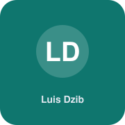

# Proyecto Arquitectura de Software 2026 — Equipo G4 (VitalLogix)

Repositorio oficial del **Equipo G4** para la asignatura de **Arquitectura de Software** (Universidad Autónoma de Yucatán — Facultad de Matemáticas).  
El repositorio está organizado por entregas en carpetas públicas independientes.

---

## Integrantes del Equipo

| Foto | Nombre Completo | Rol / GitHub |
| :---: | :--- | :--- |
|  | **Osorio Muñoz, Jaime A.** | Desarrollador / Arquitectura (`@jaimeo13`) |
|  | **Dzib Pech, Luis Gilberto** | Desarrollador / Arquitectura (`@LuisGilDzib`) |
|  | **Solis Chen, Wimon Rafael** | Desarrollador / Arquitectura |

> **Nota para el equipo:** Sustituye los archivos `img/integrantes/jaime-osorio.svg`, `img/integrantes/luis-dzib.svg` y `img/integrantes/wimon-solis.svg` por las fotografías reales (`.jpg` o `.png`) y actualiza la extensión en la tabla superior.

---

## Entregas del Proyecto

| Entrega | Carpeta Pública | Descripción | Estado |
| :--- | :--- | :--- | :---: |
| **Proyecto Final — CRUD en un Framework** | [`CRUD-VitalLogix-ProyectoF/`](CRUD-VitalLogix-ProyectoF/) | Aplicación CRUD completa sobre **Spring Boot 4 + React 19 + MySQL 8.0 + Docker**, con tabla inicial conectada a MySQL, selección múltiple, eliminación por lote, paginación, búsqueda, sesiones JWT, ventanas flotantes, manejo de excepciones, diagramas UML, documentación PDF y Javadoc HTML. | Completada |

---

## Enlaces Rápidos de la Entrega Actual

- [Carpeta de la entrega (`CRUD-VitalLogix-ProyectoF/`)](CRUD-VitalLogix-ProyectoF/)
- [Documentación Técnica Completa (PDF)](CRUD-VitalLogix-ProyectoF/Documentacion_VitalLogix_CRUD.pdf)
- [Documentación Javadoc HTML (`javadoc/index.html`)](CRUD-VitalLogix-ProyectoF/javadoc/index.html)
- [Diagramas UML (Componentes, Clases y Secuencias)](CRUD-VitalLogix-ProyectoF/diagramas/)
- [Código Fuente Completo (`backend` + `frontend` + `Docker MySQL`)](CRUD-VitalLogix-ProyectoF/codigo-fuente/)
- [Video Demostrativo en YouTube](https://youtu.be/D90ekEZowrc)
